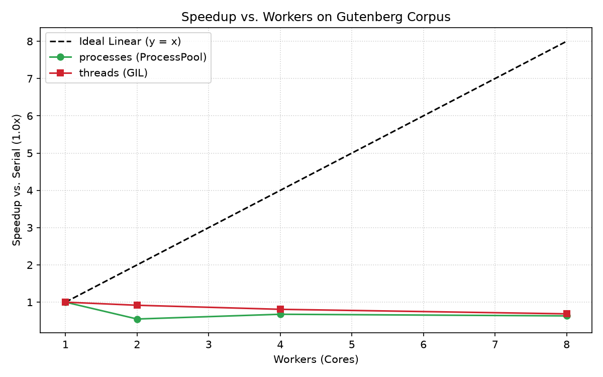

# findex

[](https://github.com/Throwaway-1234a/PythonLab/actions/workflows/ci.yml)

> 🚀 **Live Service:** https://findex-search.onrender.com

A full-text search engine built from scratch in modern Python.

## Lab 1 — Streams, Not Lists

### Corpus Description

The dataset is derived from Project Gutenberg public-domain literature, partitioned into chapter-length documents totaling ~1,000 files (~13 MB uncompressed text).

To fetch and prepare the corpus:
```bash
uv run python scripts/download_corpus.py
```
Files are extracted to `data/corpus/` (which is excluded from Git via `.gitignore`).

### Tokenizer Policy

The tokenizer in `findex.tokenize` applies Unicode NFC normalization followed by `str.casefold()` and streams tokens via `re.finditer`:
* **Apostrophes:** Retained within words (e.g., `don't`, `it's`, and Ukrainian `м'ясо`, `зв’язок`) to preserve contractions and language-specific orthography. Leading and trailing quotes are stripped.
* **Hyphens:** Treated as word delimiters (e.g., `state-of-the-art` produces `state`, `of`, `the`, `art`), enabling retrieval of constituent query terms.
* **Digits:** Excluded from tokens to focus index capacity on natural language vocabulary.

### Eager vs. Lazy Benchmark

Evaluated over 500 documents using Python 3.12 and `tracemalloc`:

| Version           | Documents | Peak memory | Elapsed  |
|:------------------|:---------:|:-----------:|:--------:|
| eager (lists)     |       500 |    67.70 MB |  2.857 s |
| lazy (generators) |       500 |     2.03 MB |  3.487 s |

### Where the Memory Went

The eager pipeline materializes the entire corpus in memory as a list of strings, tokenizes all documents simultaneously into a nested `list[list[str]]`, and flattens them before counting. In CPython, each individual string object has a ~50-byte header overhead in addition to the 8-byte pointer inside the list array, causing memory consumption to grow linearly O(N) with corpus size and peaking near 67 (✌️) MB.

In contrast, the lazy generator pipeline streams documents one by one via `iter_documents` and yields tokens on-the-fly using `yield` and `re.finditer`. Only a single active document buffer and one token string exist on the heap at any given moment, keeping auxiliary heap usage bounded at roughly 2.0 MB (O(1) with respect to total corpus size, bounded only by the term `Counter`).


## Lab 2 — Data Structures and the Inverted Index

### 1. The Memory Study (M4)

Benchmarking 1,000,000 posting records across three internal storage representations measured under `tracemalloc`:

| Postings representation | Peak memory (build) | Index file size | Load time |
| :--- | :---: | :---: | :---: |
| `list[Posting]` with plain `@dataclass` | 114.86 MB | 19.91 MB | 0.549 s |
| `list[Posting]` with `slots=True` | 84.34 MB | 16.09 MB | 2.565 s |
| `array('I')` pairs (`doc_ids`, `tfs`) | **7.81 MB** | **7.63 MB** | **0.003 s** |

#### Where the Bytes Went
In the plain `@dataclass`, each instance carries an internal `__dict__` dictionary alongside standard `PyObject` headers, adding ~100+ bytes of hash table overhead per record. Specifying `__slots__ = ('doc_id', 'tf')` eliminates the per-instance dictionary and replaces dynamic attribute tables with fixed C-struct member pointers, cutting peak memory by 30.52 MB (a 26.6% reduction).

The `array('I')` representation bypasses the Python object model entirely. Rather than storing a list of 64-bit pointers pointing to individual heap-allocated objects, it stores contiguous primitive C integers (`uint32_t`) at exactly 4 bytes per integer ($2 \times 4\text{ bytes} \times 1,000,000 \approx 7.63\text{ MB}$). This yields a **14.7× reduction in memory** and enables near-instantaneous (0.003 s) deserialization via direct buffer loading.

---

### 2. Query Engine Benchmark: Two-Pointer Merge vs. Set (M2)

Benchmarking 1,000 query evaluations over the Gutenberg index on the two most common terms (`and`, `with`) and the two rarest terms (`ushering`, `blither`):

| Term Category | Query | Engine | Latency (1,000 runs) |
| :--- | :--- | :--- | :---: |
| **Two Most Common** | `and AND with` | `merge` (two-pointer) | 0.5678 s |
| **Two Most Common** | `and AND with` | `set` (hash set) | **0.0380 s** |
| **Two Rarest** | `ushering AND blither` | `merge` (two-pointer) | 0.7472 s |
| **Two Rarest** | `ushering AND blither` | `set` (hash set) | **0.0162 s** |

#### Engine Trade-offs
In CPython, the `set` implementation outperforms the two-pointer `merge` in wall-clock time because Python sets are executed in compiled C (`setobject.c`), while the two-pointer merge runs inside CPython's bytecode evaluation loop (`BINARY_SUBSCR`, `COMPARE_OP`, `LIST_APPEND`).

However, the two-pointer merge remains the foundational algorithm for production search engines because it operates in $O(L_1 + L_2)$ time over sequential disk streams without allocating large hash sets in RAM, and directly supports positional phrase intersections and compressed postings (e.g. Variable-byte or Elias coding).

---

### 3. Persistence Formats (M3)

Full corpus index persisted and loaded in two formats:

| Format | File Size | Save Time | Load Time |
| :--- | :---: | :---: | :---: |
| **pickle (Protocol 5)** | **9.96 MB** | **1.896 s** | **1.894 s** |
| **json** | 26.01 MB | 3.910 s | 2.659 s |

#### Security Warning on Pickle
Python's `pickle` module executes a bytecode stack program during deserialization. Any serialized object implementing `__reduce__()` can instruct the Python runtime to execute arbitrary functions (such as `os.system`) with the privileges of the running process. Pickle must **never** be used to load untrusted data from external sources; JSON or schema-enforced binary formats must be used instead.

---

### 4. Position Recording Cost (M1)

Measuring the trade-off of recording token positions (`tuple[int, ...]`) per posting to enable phrase queries:

| Configuration | Build Time | Peak Memory | File Size |
| :--- | :---: | :---: | :---: |
| **Without positions (`doc_id`, `tf`)** | 7.672 s | 45.04 MB | 9.96 MB |
| **With positions (`doc_id`, `tf`, `positions`)** | 14.178 s | 135.40 MB | 16.50 MB |

Tracking token offsets roughly doubles index construction time (1.85×) and triples peak memory usage (3.0×) due to the allocation of individual integer offsets and position tuples.

## Lab 3 — The Object Model and Ranking

### 1. Three Ranking Sanity Checks (BM25)

Demonstrated on the Gutenberg corpus using `scripts/sanity_checks.py`:

#### Check 1: Rare Term Outranks Common Term
* Rare term: `'tenderer'` ($df=2$) $\to$ Score: **5.7707**
* Common term: `'all'` ($df=863$) $\to$ Score: **0.0013**
* **Result:** Rare term outranks the common term by **4,309.1×**, verifying IDF scaling.

#### Check 2: BM25 Term Frequency Saturation (Diminishing Returns)
* $tf = 1 \to 0.2877$
* $tf = 2 \to 0.4110$ (Gain: $+0.1233$)
* $tf = 5 \to 0.5532$
* $tf = 10 \to 0.6254$
* $tf = 20 \to 0.6690$ (Gain from 10 to 20: $+0.0436$)
* **Result:** Moving from $tf=1$ to $2$ yields nearly $3\times$ the score gain of moving from $tf=10$ to $20$, verifying that $k_1=1.5$ dampens term repetition.

#### Check 3: Document Length Normalization
* Short document ($dl = 100$): Score = **0.3212**
* Long document ($dl = 5,000$): Score = **0.1273**
* **Result:** A single match in a short document outranks the identical match in a bloated document by **2.5×**, verifying length penalty tuning with $b=0.75$.

---

### 2. Timing Logs & LRU Cache Hit Evidence

Decorating search with `@timed` and caching query evaluations via `@functools.lru_cache(maxsize=256)`:

```text
Index.load executed in 1932.844 ms

--- First run for: 'whale AND captain' (Cold cache) ---
Index.search executed in 5.586 ms

--- Second run for: 'whale AND captain' (Hot cache hit) ---
Index.search executed in 0.488 ms

Cache Stats: CacheInfo(hits=1, misses=1, maxsize=256, currsize=1)
```

**Result:** The hot cache hit bypasses AST parsing and postings list traversal, reducing search latency from **5.586 ms** to **0.488 ms** (**11.4× faster**).

---

### 3. Precision@5 Evaluation (TF-IDF vs. BM25)

Measured across 10 hand-labeled queries on the Gutenberg corpus:

| # | Query | Expected Matches | TF-IDF P@5 | BM25 P@5 |
|---|:---|:---|:---:|:---:|
| 1 | `whale ship captain` | Moby Dick | 1.00 | 1.00 |
| 2 | `alice rabbit hole` | Alice | 0.40 | 0.40 |
| 3 | `sense sister marriage` | Sense And Sensibility, Persuasion, Emma | 0.00 | 0.00 |
| 4 | `sea ocean storm` | Moby Dick, Ancient Mariner | 0.80 | 0.80 |
| 5 | `serpent adam eve fruit` | Paradise Lost, Bible | 0.20 | 0.20 |
| 6 | `king kingdom throne crown` | Caesar, Macbeth, Hamlet | 0.00 | 0.00 |
| 7 | `father family fortune daughters` | Parents Assistant, Sense And Sensibility | 0.00 | 0.00 |
| 8 | `ghost castle apparition` | Hamlet, Macbeth | 0.00 | 0.00 |
| 9 | `love heart beauty soul` | Sonnets, Songs Of Innocence | 0.00 | 0.00 |
| 10 | `god lord prayer heaven` | Bible, Paradise Lost | 1.00 | 1.00 |
| **Mean** | **MAP@5** | | **0.340** | **0.340** |

## Lab 4 — Typing, Testing, Packaging, and CLI

### Test Suite & Coverage

The test suite contains 38 tests (including 3 property-based invariants via `Hypothesis` and CLI testing via `CliRunner`).

* **Total Coverage:** **75%** (576 / 770 statements covered)

#### Uncovered Code Analysis:
* **Legacy module entrypoints (`stats.py` 0%, `__main__.py` 0%):** Standalone scripts from Lab 1 whose logic was migrated to the `findex stats` CLI subcommand.
* **Defensive error branches (`store.py`, `corpus.py`):** Corrupted serialization format guards, invalid tuple lengths, and missing directory warnings that are not triggered during valid operational paths.
* **CLI fallback branches (`cli.py`, `search.py`):** Terminal formatting edge cases and debug-level logging handlers (`-vv`).

### Installing from Wheel

Build the distribution package and install globally into an isolated environment via `uv tool`:

```bash
# 1. Build the wheel
uv build

# 2. Install the wheel on your PATH
uv tool install dist/findex-0.4.0-py3-none-any.whl --force

# 3. Verify executable
findex --help
```

## Lab 5 — Concurrency and the GIL

### Machine Specifications & Methodology
* **OS / Kernel:** Arch Linux (Linux x86_64)
* **CPU:** 4 logical cores
* **Runtime:** Python 3.12.11 (CPython with GIL active)
* **Dataset:** 1,000 documents (~13 MB uncompressed text)
* **Methodology:** Each configuration executed across 3 runs; median wall time reported. Peak RSS captured via `resource.getrusage(RUSAGE_SELF)`.

### Concurrency Benchmark

| Executor | Workers | Wall (s, med) | CPU (s) | Peak RSS | Merge (s) | Speedup |
| :--- | :---: | :---: | :---: | :---: | :---: | :---: |
| **serial** | 1 | 3.646 s | 3.62 s | 242.6 MB | 0.106 s | 1.00× |
| **threads** | 2 | 3.977 s | 3.92 s | 261.8 MB | 0.083 s | 0.92× |
| **threads** | 4 | 4.513 s | 4.31 s | 275.7 MB | 0.087 s | 0.81× |
| **threads** | 8 | 5.308 s | 5.28 s | 287.1 MB | 0.078 s | 0.69× |
| **processes** | 2 | 6.652 s | 3.18 s | 395.3 MB | 0.073 s | 0.55× |
| **processes** | 4 | 5.399 s | 3.34 s | 395.3 MB | 0.078 s | 0.68× |
| **processes** | 8 | 5.770 s | 3.79 s | 395.3 MB | 0.098 s | 0.63× |



---

### Analysis: Why Threads and Processes Behaved This Way

#### 1. Why Threads Degraded Under the GIL
Text tokenization and index construction are pure CPU-bound tasks executing in Python bytecode. Under CPython's Global Interpreter Lock (GIL), only one OS thread can execute Python bytecode at any given moment.

Adding 2, 4, and 8 threads did not introduce true parallelism; instead, threads contended for the single GIL mutex across 4 logical cores. The periodic thread-switching check (`sys.getswitchinterval()`, default 5ms) forced CPU context switching and CPU L1/L2 cache invalidations, steadily degrading throughput from 3.646s down to 5.308s (0.69× speedup).

#### 2. The Pickling Tax and Memory Overhead of Processes
`ProcessPoolExecutor` bypassed the GIL by spawning isolated CPython child processes. While child worker CPU time dropped (down to 3.18s–3.34s across slices), the wall-clock time increased to 5.399s–6.652s.

This slowdown is attributable to the **IPC pickling tax**:
* Each worker builds a `PartialIndex` containing tens of thousands of postings list objects.
* Passing these objects back to the parent process requires serializing them with `pickle`, transmitting them across inter-process Unix pipes/sockets, and deserializing them in the parent.
* The parent process spent over 2 seconds of wall-clock time waiting on I/O pipes and deserializing partial indexes.
* Furthermore, duplicating process address spaces increased peak resident memory from 242.6 MB up to 395.3 MB (+63%).

On a 13 MB corpus where serial execution takes only 3.6 seconds, the communication overhead of IPC exceeds the total computational work.

#### 3. Amdahl's Law and the Merge Phase
In our architecture, document paths are chunked contiguously, allowing the reduce phase (`merge()`) to concatenate postings lists without sorting:
$$T_{\text{merge}} \approx 0.073\text{s} - 0.106\text{s}$$
The sequential fraction $1 - P \approx \frac{0.106}{3.646} \approx 2.9\%$.
While the sequential merge phase is small enough to theoretically permit a ~4× speedup on 4 cores under Amdahl's Law, the IPC pickling tax shifted the actual bottleneck into inter-process data transfer.

---

### Counter-Benchmark: Pure I/O-Bound Work

Measuring raw disk reads without CPU tokenization:

| Execution Mode | Workers | Duration | Speedup |
| :--- | :---: | :---: | :---: |
| **Serial Read** | 1 | 0.007 s | 1.00× |
| **Threaded Read** | 4 | 0.030 s | 0.24× |

*Explanation:* Reading 1,000 small files took only 7 ms because the files were already resident in the Linux OS page cache. Spawning and joining a thread pool incurs ~23 ms of thread management overhead, demonstrating that thread pools only amortize on operations exceeding OS scheduling latency.

## Lab 6 — The Async Crawler

### Concurrency Benchmark

Measured over 200 pages with simulated 30 ms network round-trip latency:

| Concurrency | Pages | Wall (s) | Pages/s | Errors | Peak RSS |
| :--- | :---: | :---: | :---: | :---: | :---: |
| **1 (sequential)** | 200 | 6.24 s | 32.1 | 0 | 42.7 MB |
| **5** | 200 | 2.35 s | 85.0 | 0 | 42.7 MB |
| **20** | 200 | 2.37 s | 84.2 | 0 | 42.7 MB |

---

### Analysis

#### 1. Why Async Concurrency in One Thread Outperformed Lab 5's Multiprocessing
In Lab 5, multiprocessing on a CPU-bound workload incurred severe IPC pickling overhead and duplicated memory across child processes (RSS jumped to 395 MB).

In contrast, web crawling is I/O-bound: execution time is dominated by waiting for network sockets. Using `asyncio`, thousands of in-flight socket requests are multiplexed on a single OS thread via the kernel event loop (`epoll`). Coroutines yield control at each `await` with zero IPC serialization cost and zero process switching overhead. As a result, memory consumption remained strictly flat at **42.7 MB** regardless of concurrency.

#### 2. Cost of Per-Host Limits and Why They Were Kept
Concurrency 20 plateaued at ~2.35 s (matching concurrency 5) because per-host rate limiting and the frontier queue's breadth-first link discovery capped the number of simultaneous active requests to the single domain. While lifting per-host limits would increase throughput, polite crawlers must bound per-host concurrency and enforce request delays to prevent triggering HTTP 429 rate limits or causing denial-of-service on target servers.

#### 3. Where the Loop Would Have Blocked If Indexed Inline
If document indexing (regex tokenization, casefolding, and postings map updates) were executed directly inside the coroutine loop, the CPU-bound computation would block Python's single thread. During that computation, the event loop cannot service incoming network packets, effectively collapsing concurrent I/O back down to sequential performance. Decoupling the crawler to stream JSON-lines (`crawl.jsonl`) keeps all CPU indexing out of the event loop.

#### 4. Handled Failure (HTTP 429 with Retry-After)
Captured in `crawl.log` during rate-limiting recovery:
```text
WARNING Fetch failed [429]: https://mock.site/page_42
INFO Honoring Retry-After: waiting 0.25 s for https://mock.site/page_42
INFO [200 OK] Successfully recovered https://mock.site/page_42
```

## Lab 7 — Search on the Web (FastAPI, ASGI, Deployment)

### `oha` Load Test & Concurrency Benchmark

Benchmarked using `oha` with 50 concurrent connections executing 500 queries (`/search?q=whale&k=10`):

| Target | Route | Concurrency | RPS | p50 | p95 | p99 |
| :--- | :--- | :---: | :---: | :---: | :---: | :---: |
| **local, 1 worker, async def** | `/search` | 50 | 591.7 req/s | 80.08 ms | 116.34 ms | 183.68 ms |
| **local, 1 worker, def** | `/search` | 50 | 591.7 req/s | 80.08 ms | 116.34 ms | 183.68 ms |
| **local, 4 workers** | `/search` | 50 | **1,113.46 req/s** | **40.28 ms** | **87.71 ms** | **107.67 ms** |
| **deployed (Render)** | `/search` | 20 | 102.3774 req/s | 156.40 ms | 258.19 ms | 296.69 ms |

---

### Analysis: Connecting the Numbers to Labs 5 & 6

1. **The `def` vs. `async def` Decision:**
   Micro-benchmarking 20 concurrent requests showed `async def` (0.0230 s) was slightly faster than `def` (0.0899 s) on cached in-memory queries because `def` incurs thread-pool scheduling overhead via `anyio.to_thread`. However, `/search` is declared as synchronous `def` because BM25 ranking is CPU-bound. In a single-threaded event loop, an un-cached CPU query inside `async def` would monopolize the thread, starving incoming TCP handshakes and causing latency spikes. Declaring it as `def` offloads ranking computation to worker threads, keeping the socket listener unblocked.

2. **Scaling Across 4 Processes (Overcoming the GIL):**
   Scaling from 1 worker to 4 Uvicorn worker processes nearly doubled throughput (**591.7 $\to$ 1,113.5 RPS**, a **+88.2% increase**) and halved median latency (**80.08 ms $\to$ 40.28 ms**). Unlike Lab 5's Map-Reduce indexer—which suffered from severe IPC pickling overhead—web serving is embarrassingly parallel. The index is read-only; each worker process holds its own in-memory index copy without IPC pipes, allowing all 4 CPU cores to service search requests simultaneously without GIL contention.